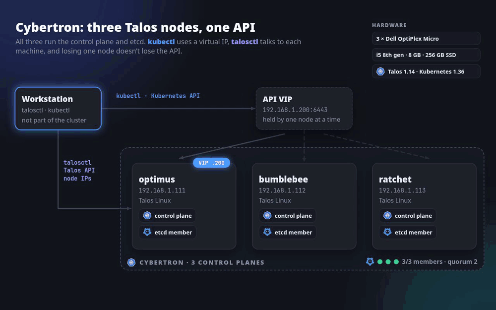
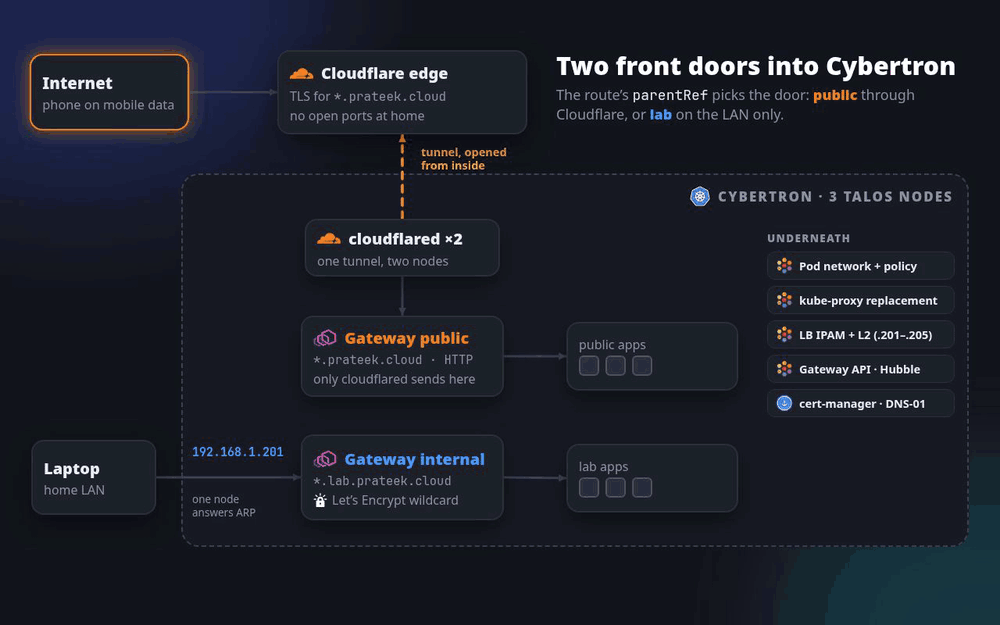

# Homelab

Commands and manifests for **Cybertron**, a three-node Talos Linux Kubernetes
cluster on refurbished mini PCs, as built in the blog series. Each folder
matches one part.

It's a cluster to break on purpose: networking, storage, observability,
GitOps, upgrades and node failures on real machines, real Ethernet and real
disks, without paying for cloud resources or breaking an environment someone
else depends on.

| Part | Post | Folder |
| --- | --- | --- |
| 1. A highly available cluster with Talos Linux | [Building a 3-Node Highly Available Kubernetes Homelab with Talos Linux](https://blog.prateekjain.dev/building-a-3-node-highly-available-kubernetes-homelab-with-talos-linux-0372066fe49c?sk=4c66cf9181999f9db19ac3aacabcd8e8) | [`talos/`](talos/README.md) |
| 2. Networking: Cilium, Gateway API, cert-manager, Cloudflare Tunnel | coming soon | [`networking/`](networking/README.md) |
| 3. Storage | planned | |

## The cluster

Three identical machines, all control planes, all running workloads:

| Node | Address | Role |
| --- | --- | --- |
| optimus | 192.168.1.111 | Control plane, etcd, workloads |
| bumblebee | 192.168.1.112 | Control plane, etcd, workloads |
| ratchet | 192.168.1.113 | Control plane, etcd, workloads |

- **Kubernetes API VIP:** `https://192.168.1.200:6443`. Talos moves it to a
  healthy control plane, so `kubectl` doesn't depend on any one machine.
- **etcd:** three members, quorum two. One node can go down; two can't.
- **No SSH:** Talos is immutable and managed through its API. `talosctl` talks
  to each node's own IP (machine: config, disks, logs, upgrades); `kubectl`
  talks to the Kubernetes API through the VIP.
- **Node addresses** come from DHCP reservations on the router. The VIP and
  the LoadBalancer range are reserved too, so DHCP never hands them to another
  device.

### Hardware

| | Each node |
| --- | --- |
| Machine | Dell OptiPlex Micro (refurbished) |
| CPU | Intel Core i5, 8th gen |
| Memory | 8 GB DDR4 |
| Disk | 256 GB SATA SSD |
| Network | Wired Ethernet to the home router |

Lenovo ThinkCentre Tiny or HP EliteDesk/ProDesk Mini machines work the same
way; nothing here depends on Dell.

## Networking

Cilium is the CNI and replaces kube-proxy. Apps are reached through one of two
Gateways, and the route's `parentRef` decides which:

| | Lab apps | Public apps |
| --- | --- | --- |
| Names | `<app>.lab.prateek.cloud` | `<app>.prateek.cloud` |
| Reached from | The home LAN only | The internet |
| Path | LAN → `192.168.1.201` → Gateway `internal` → pods | Cloudflare edge → tunnel → cloudflared ×2 → Gateway `public` → pods |
| TLS | Let's Encrypt wildcard from cert-manager (DNS-01, so no inbound access needed) | Cloudflare's edge certificate |

- **LoadBalancer IPs:** Cilium LB IPAM hands out `192.168.1.201–205`, and L2
  announcements make one node answer ARP for each IP (it moves if that node goes
  down).
- **No open ports at home:** public traffic arrives through one shared
  Cloudflare Tunnel that the cluster opens from the inside.
- **NetworkPolicy is enforced** (it wasn't with Flannel), and Hubble shows
  every flow and drop.

Details and the full migration from Flannel: [`networking/`](networking/README.md).

## Versions

| Component | Version |
| --- | --- |
| Talos Linux | 1.14.0 |
| Kubernetes | 1.36.3 |
| Cilium | 1.20.2 |
| Gateway API CRDs | v1.6.1 |
| cert-manager | v1.21.2 |
| cloudflared | 2026.10.0 |

## What's next

- **Storage:** a Talos user volume on each node's SSD and Longhorn for
  replicated volumes, plus Tailscale for remote `kubectl` and `talosctl`.
- **Later:** observability (Prometheus, Grafana), GitOps with Argo CD, backups,
  and security tooling.

## Repository layout

| Path | What |
| --- | --- |
| [`talos/`](talos/README.md) | Part 1: install, bootstrap and validate the Talos cluster |
| [`networking/`](networking/README.md) | Part 2: Cilium, LB IPAM, Gateways, cert-manager, Cloudflare Tunnel, demo app and tests |
| `assets/` | Diagrams used in this README |

Replace the domain and `192.168.1.x` addresses with your own. Credentials never
go in this repository: generated Talos configuration, `talosconfig`,
`kubeconfig`, API tokens and tunnel credentials stay local (see `.gitignore`)
or in Kubernetes Secrets created by hand.
