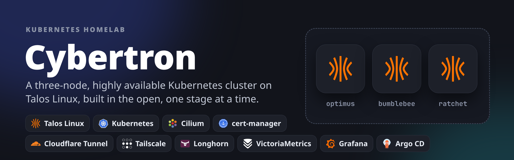
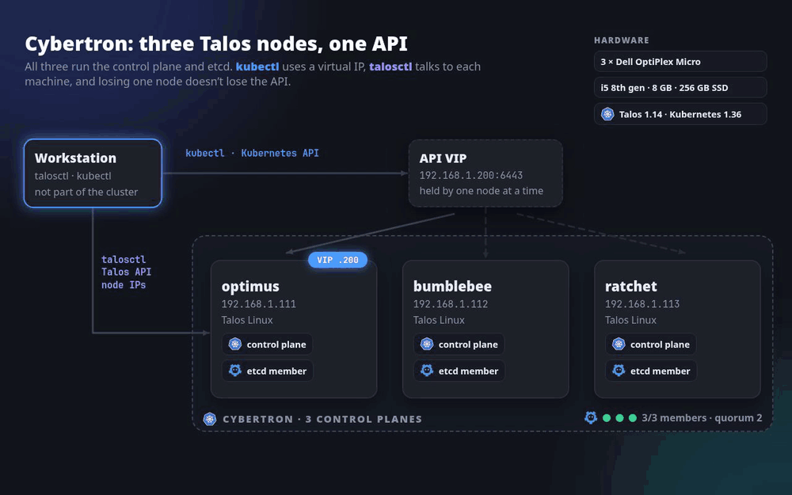
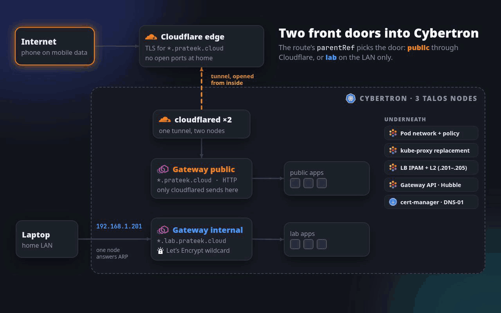
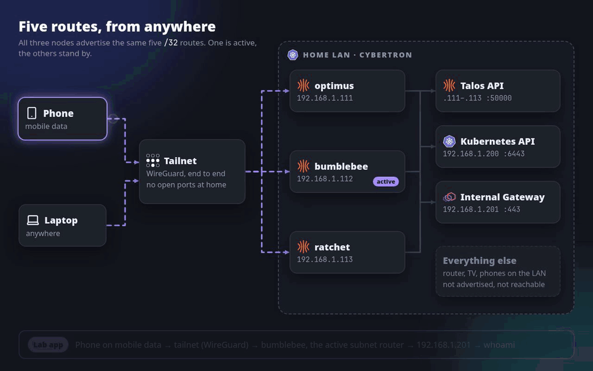
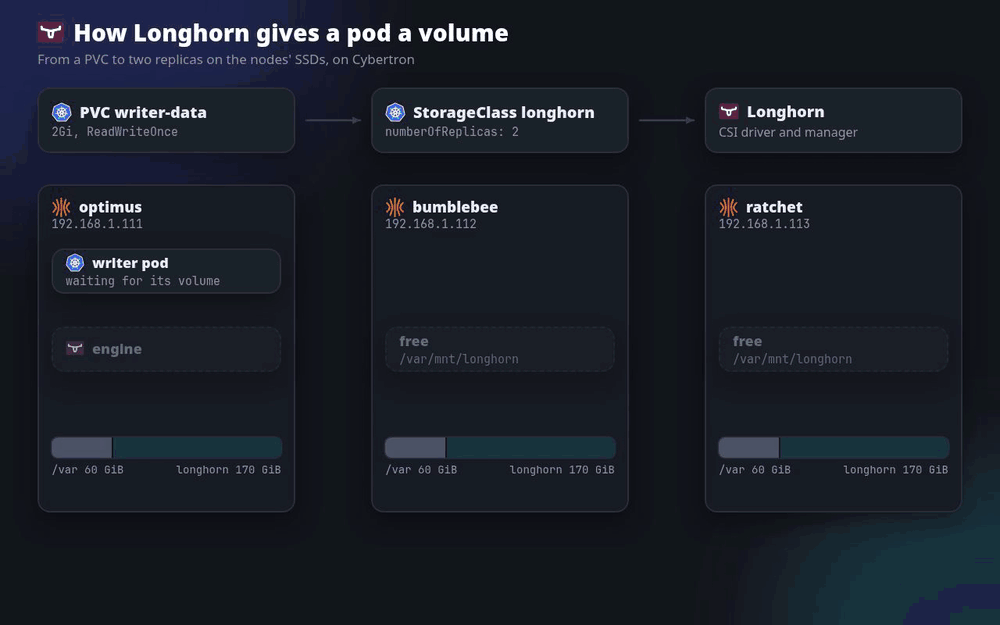
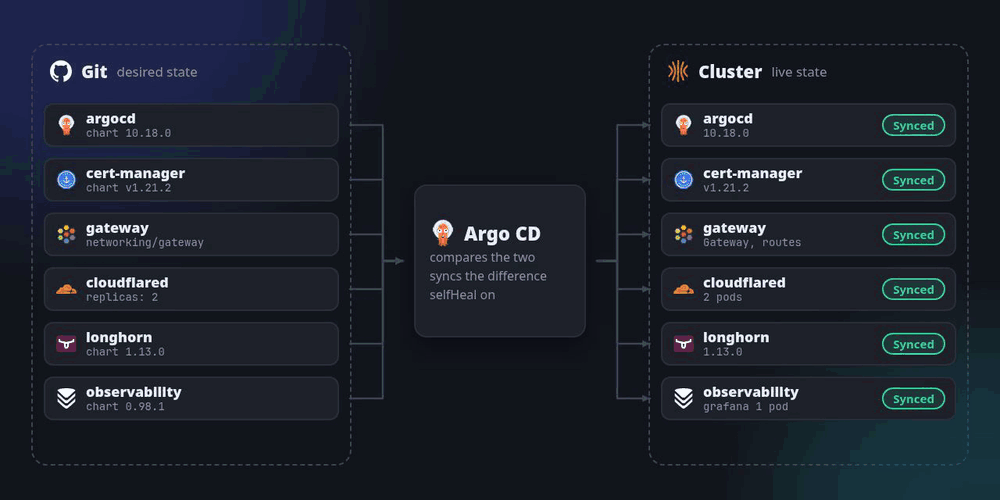

# Homelab

Commands and manifests for **Cybertron**, a three-node Talos Linux Kubernetes
cluster on refurbished mini PCs, as built in the blog series. Each folder
matches one part.

It's a cluster to break on purpose: networking, storage, observability,
GitOps, upgrades and node failures on real machines, real Ethernet and real
disks, without paying for cloud resources or breaking an environment someone
else depends on.

| Part | Post | Folder |
| --- | --- | --- |
| 1. A highly available cluster with Talos Linux | [Building a 3-Node Highly Available Kubernetes Homelab with Talos Linux](https://blog.prateekjain.dev/building-a-3-node-highly-available-kubernetes-homelab-with-talos-linux-0372066fe49c?sk=4c66cf9181999f9db19ac3aacabcd8e8) | [`talos/`](talos/README.md) |
| 2. Networking: Cilium, Gateway API, cert-manager, Cloudflare Tunnel | [Networking a 3-Node Kubernetes Homelab with Cilium, Gateway API and Cloudflare Tunnel](https://blog.prateekjain.dev/networking-a-kubernetes-homelab-cilium-gateway-api-and-cloudflare-tunnel-on-talos-362f548a2f3d?sk=d454cd4eaff4ce8a8fd0cd8e6b3d82f6) | [`networking/`](networking/README.md) |
| 3. Remote access with Tailscale | [Tailscale on Talos Linux: Secure Remote Access to a Kubernetes Homelab](https://blog.prateekjain.dev/tailscale-on-talos-linux-secure-remote-access-to-a-kubernetes-homelab-8a082d903682?sk=c4ec5ac1e782a83b5dc785211d9fd082) | [`tailscale/`](tailscale/README.md) |
| 4. Omni | [Importing an Existing Talos Cluster into Omni](https://blog.prateekjain.dev/bb1fc7722eda?source=friends_link&sk=a4c4412829ef81542ca4892a0edbecec) | [`omni/`](omni/README.md) |
| 5. Storage with Longhorn | [Persistent Storage for a 3-Node Talos Homelab with Longhorn](https://blog.prateekjain.dev/persistent-storage-for-a-3-node-talos-homelab-with-longhorn-587c05356b73?source=friends_link&sk=9093231c2d278ba92fd493098fbe237d) | [`storage/`](storage/README.md) |
| 6. Observability with VictoriaMetrics | [Metrics, Logs and Alerts for a 3-Node Talos Homelab with VictoriaMetrics](https://blog.prateekjain.dev/metrics-logs-and-alerts-for-a-3-node-talos-homelab-with-victoriametrics-0f4a91b9d44e?sk=751eedebb5d54cc15561d59abb7e52d8) | [`observability/`](observability/README.md) |
| 7. GitOps with Argo CD | [GitOps for a 3-Node Talos Kubernetes Homelab with Argo CD](https://blog.prateekjain.dev/gitops-for-a-3-node-talos-kubernetes-homelab-with-argo-cd-336c076e93cc?source=friends_link&sk=ebda84ecdc3e2458fead2638374be51e) | [`gitops/`](gitops/README.md) |

## The cluster

Three identical machines, all control planes, all running workloads:

| Node | Address | Role |
| --- | --- | --- |
| optimus | 192.168.1.111 | Control plane, etcd, workloads |
| bumblebee | 192.168.1.112 | Control plane, etcd, workloads |
| ratchet | 192.168.1.113 | Control plane, etcd, workloads |

- **Kubernetes API VIP:** `https://192.168.1.200:6443`. Talos moves it to a
  healthy control plane, so `kubectl` doesn't depend on any one machine.
- **etcd:** three members, quorum two. One node can go down; two can't.
- **No SSH:** Talos is immutable and managed through its API. `talosctl` talks
  to each node's own IP (machine: config, disks, logs, upgrades); `kubectl`
  talks to the Kubernetes API through the VIP.
- **Node addresses** come from DHCP reservations on the router. The VIP and
  the LoadBalancer range are reserved too, so DHCP never hands them to another
  device.

### Hardware

| | Each node |
| --- | --- |
| Machine | Dell OptiPlex Micro (refurbished) |
| CPU | Intel Core i5, 8th gen |
| Memory | 8 GB DDR4 |
| Disk | 256 GB SATA SSD |
| Network | Wired Ethernet to the home router |

Lenovo ThinkCentre Tiny or HP EliteDesk/ProDesk Mini machines work the same
way; nothing here depends on Dell.

## Networking

Cilium is the CNI and replaces kube-proxy. Apps are reached through one of two
Gateways, and the route's `parentRef` decides which:

| | Lab apps | Public apps |
| --- | --- | --- |
| Names | `<app>.lab.prateek.cloud` | `<app>.prateek.cloud` |
| Reached from | The home LAN only | The internet |
| Path | LAN → `192.168.1.201` → Gateway `internal` → pods | Cloudflare edge → tunnel → cloudflared ×2 → Gateway `public` → pods |
| TLS | Let's Encrypt wildcard from cert-manager (DNS-01, so no inbound access needed) | Cloudflare's edge certificate |

- **LoadBalancer IPs:** Cilium LB IPAM hands out `192.168.1.201–205`, and L2
  announcements make one node answer ARP for each IP (it moves if that node goes
  down).
- **No open ports at home:** public traffic arrives through one shared
  Cloudflare Tunnel that the cluster opens from the inside.
- **NetworkPolicy is enforced** (it wasn't with Flannel), and Hubble shows
  every flow and drop.

Details and the full migration from Flannel: [`networking/`](networking/README.md).

## Remote access

Tailscale runs on all three nodes as a Talos system extension, so `kubectl`,
`talosctl` and the lab apps work from anywhere with the same addresses,
certificates, kubeconfig and talosconfig as at home.

- **Five /32 routes, not the LAN:** the three node addresses (Talos API), the
  API VIP `192.168.1.200` and the internal Gateway `192.168.1.201`. The router,
  phones and everything else on the network stay unreachable.
- **High availability:** every node advertises the same routes; one is active
  and another takes over when it goes down.
- **Access policy:** members of the tailnet reach only ports 80/443 on the
  Gateway, 6443 on the VIP and 50000 on the nodes. The nodes are tagged devices
  with no key expiry, and the auth key is revoked after they join.
- **No open ports at home**, and the Talos API stays reachable even when
  Kubernetes is down.

Details, the gotchas (node IPs, Cilium MTU, extension config before the
upgrade) and the failover test: [`tailscale/`](tailscale/README.md).

## Storage

Each node's single SSD is split in two: a 60 GiB `/var` for Talos and a
170 GiB user volume at `/var/mnt/longhorn`. Longhorn replicates volumes across
the nodes and is the default StorageClass.

- **Two replicas per volume** on different nodes, so a node can go down and
  Longhorn still has a third node to rebuild the missing copy on. That's
  255 GiB of volumes in total.
- **Snapshots** every hour, kept for a day; optional **backups** every night
  to AWS S3, kept for two weeks.
- **Node failures:** a pod on a powered-off node is force-deleted and its
  volume attaches where the replacement runs.
- **UI** at `https://longhorn.lab.prateek.cloud`, LAN and tailnet only (it has
  no login).

Details, the EPHEMERAL reset and the failure tests: [`storage/`](storage/README.md).

## Observability

VictoriaMetrics instead of kube-prometheus-stack, and VictoriaLogs instead of
Loki: the same PromQL, dashboards and alert rules, with less RAM on 8 GB nodes.

- **Metrics** from every node, pod, Longhorn volume and the control plane
  (controller manager, scheduler, etcd), kept for a month.
- **Logs** from every pod, searchable in the same Grafana.
- **Grafana** at `https://grafana.lab.prateek.cloud`, LAN and tailnet only.
- **Alerts** on Telegram, with critical alerts muting the matching warnings,
  and a Healthchecks.io dead-man check that messages when alerting stops.
- Metrics and logs sit on a single-replica Longhorn class; Grafana keeps two.

Details and the alert tests: [`observability/`](observability/README.md).

## GitOps

Argo CD runs the cluster from this repository: a `git push` changes the
cluster, and a change made directly in the cluster is put back within minutes.

- **App of apps:** one root Application, applied once, creates an Application
  for every file in `gitops/apps/`.
- **Adopted in place:** cert-manager, the Gateways, cloudflared, Longhorn and
  the observability stack moved from Helm to Argo CD with no reinstall, by
  keeping the Helm release names.
- **Argo CD manages itself**, with its UI at `https://argocd.lab.prateek.cloud`,
  LAN and tailnet only.
- **Kept outside:** Cilium (Argo CD runs on its network), the Omni patches and
  every Secret. Longhorn has prune off.
- **Alerts** on Discord when a sync fails or an Application turns Degraded.

Details, the CLI through the Gateway and the rollback: [`gitops/`](gitops/README.md).

## Versions

| Component | Version |
| --- | --- |
| Talos Linux | 1.14.6 |
| Kubernetes | 1.37.2 |
| Cilium | 1.20.2 |
| Gateway API CRDs | v1.6.1 |
| cert-manager | v1.21.2 |
| cloudflared | 2026.10.4 |
| Tailscale (Talos extension) | 1.102.3 |
| Longhorn | 1.13.0 |
| victoria-metrics-k8s-stack | 0.98.1 |
| Argo CD | v3.6.1 (chart 10.18.0) |

## What's next

- **Next:** creating Cybertron from Git: a new cluster from Omni, Argo CD and
  this repository, with the Secrets encrypted in it.
- **Later:** an auth proxy in front of the lab apps, and security tooling.

## Repository layout

| Path | What |
| --- | --- |
| [`talos/`](talos/README.md) | Part 1: install, bootstrap and validate the Talos cluster |
| [`networking/`](networking/README.md) | Part 2: Cilium, LB IPAM, Gateways, cert-manager, Cloudflare Tunnel, demo app and tests |
| [`tailscale/`](tailscale/README.md) | Part 3: Tailscale extension, subnet routes, access policy, failover |
| [`omni/`](omni/README.md) | Part 4: import into Omni, Talos 1.14 node patches, static IPs, undo patch |
| [`storage/`](storage/README.md) | Part 5: system extensions through Omni, the Longhorn partition, Longhorn, snapshots, optional S3 backups |
| [`observability/`](observability/README.md) | Part 6: control plane metrics through Omni, VictoriaMetrics, VictoriaLogs, Grafana, alerts to Telegram |
| [`gitops/`](gitops/README.md) | Part 7: Argo CD, the root Application, the earlier Helm releases adopted in place, sync alerts to Discord |
| [`secrets/`](secrets/README.md) | Part 8: External Secrets Operator, Bitwarden Secrets Manager, every Secret synced from one project |
| `assets/` | Diagrams used in this README |
| `.github/workflows/` | CI on every push: yamllint, kubeconform (Kubernetes 1.36 and the CRDs used), gitleaks, link check |

Replace the domain and `192.168.1.x` addresses with your own. Credentials never
go in this repository: generated Talos configuration, `talosconfig`,
`kubeconfig`, API tokens, tunnel, S3, Telegram and Discord credentials stay local (see `.gitignore`)
or in Bitwarden Secrets Manager, synced into the cluster by External Secrets (Part 8).

## License

[MIT](LICENSE). Use, copy and adapt anything here for your own lab.

## Follow the series

For the next parts, follow along on
[blog.prateekjain.dev](https://blog.prateekjain.dev),
[X (@PrateekJainDev)](https://x.com/PrateekJainDev) or
[LinkedIn (in/prateekjaindev)](https://www.linkedin.com/in/prateekjaindev).
