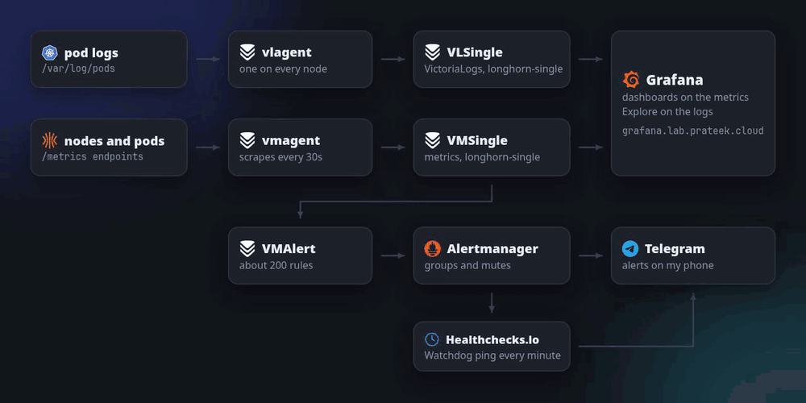

# Part 6: Observability

Companion to Part 6 of the Cybertron series: VictoriaMetrics stores metrics
from every node, pod, Longhorn volume and control plane component, VictoriaLogs
stores every pod's logs, Grafana shows both on the internal Gateway, and
Alertmanager sends alerts to Telegram, with a Healthchecks.io dead-man check
for the alerting itself.



Replace `prateek.cloud` and the `192.168.1.x` addresses with your own. Run the
commands from the repository root, in bash.

## Versions

| Component | Version |
| --- | --- |
| Talos | 1.14.6, managed by Omni (Part 4) |
| Kubernetes | 1.37.2 |
| Longhorn | 1.13.0 (Part 5) |
| victoria-metrics-k8s-stack (Helm chart) | 0.98.1 |

## Files

| Path | What |
| --- | --- |
| `omni/control-plane-metrics.yaml` | Omni config patch: controller-manager, scheduler and etcd metrics on the node IPs |
| `storageclass.yaml` | `longhorn-single`: one replica, best-effort data locality, for metrics and logs |
| `namespace.yaml` | `monitoring` with the privileged Pod Security level |
| `alertmanager.yaml` | Alertmanager config with placeholders: Telegram, the Watchdog ping, inhibit rules |
| `values.yaml` | Helm values: storage classes, VictoriaLogs, Grafana plugin and HTTPRoute, control plane scrapes, a drop rule for unused API server histograms |
| `longhorn-scrape.yaml` | VMServiceScrape for the Longhorn managers, and a NetworkPolicy that lets vmagent reach them |
| `test-alert.yaml` | A VMRule that always fires, to test the path to Telegram |

## Before you start

Tools: `omnictl`, `talosctl` 1.14, `kubectl`, `helm`, `jq`. The cluster from
Parts 1 to 5, with Longhorn installed and the internal Gateway serving
`*.lab.prateek.cloud`.

```bash
export TALOSCONFIG=~/.talos/config        # the Omni talosconfig from Part 4
talosctl -n 192.168.1.111,192.168.1.112,192.168.1.113 memory   # the "before" numbers
```

## 1. Control plane metrics

```bash
omnictl apply -f observability/omni/control-plane-metrics.yaml
```

The controller manager and scheduler restart in place. etcd can't be restarted
through the Talos API, so it only picks up the flag when its node reboots. One
node at a time, three healthy members before the next (bumblebee, with the VIP,
last):

```bash
talosctl -n 192.168.1.113 reboot
talosctl -n 192.168.1.111 etcd members
kubectl run etcd-check --rm -i --restart=Never --image=curlimages/curl:8.17.0 -- \
  curl -s http://192.168.1.113:2381/metrics | grep "^etcd_server_has_leader"
```

Check from a pod: over Tailscale the access policy from Part 3 only lets port
50000 through to the nodes, so a curl from a laptop on the tailnet times out.
These ports are reachable from the LAN and the cluster; nothing forwards them
to the internet.

## 2. Namespace and StorageClass

```bash
kubectl apply -f observability/namespace.yaml
kubectl apply -f observability/storageclass.yaml
```

## 3. Where alerts go

Telegram: open a chat with @BotFather, send `/newbot`, keep the token. Send the
new bot any message, then get the chat ID:

```bash
read -rs TG_TOKEN
curl -s "https://api.telegram.org/bot${TG_TOKEN}/getUpdates" | jq '.result[0].message.chat.id'
unset TG_TOKEN
```

Healthchecks.io: a check with a 1 minute period and 5 minute grace time,
Telegram as its integration. Copy the ping URL.

The real config holds the bot token, so it stays in `~/cybertron/`, never in git:

```bash
cp observability/alertmanager.yaml ~/cybertron/alertmanager.yaml
# fill in the token, chat ID and ping URL
kubectl -n monitoring create secret generic alertmanager-config \
  --from-file=alertmanager.yaml=$HOME/cybertron/alertmanager.yaml
```

## 4. The stack

```bash
helm repo add vm https://victoriametrics.github.io/helm-charts/
helm repo update
helm install vmks vm/victoria-metrics-k8s-stack --version 0.98.1 \
  --namespace monitoring --values observability/values.yaml
kubectl -n monitoring get pods
kubectl -n monitoring get pvc   # two on longhorn-single, Grafana's on longhorn
```

Check the scrape targets: controller manager, scheduler and etcd show three
each, all up. "Connection refused" means step 1 hasn't reached that node.

```bash
kubectl -n monitoring port-forward svc/vmagent-vmks-victoria-metrics-k8s-stack 8429
# http://localhost:8429/targets
```

## 5. Grafana and logs

Grafana is at `https://grafana.lab.prateek.cloud`, at home and over Tailscale.
Log in as `admin` and change the password:

```bash
kubectl -n monitoring get secret vmks-grafana -o jsonpath='{.data.admin-password}' | base64 -d; echo
```

Logs are in Explore, on the VictoriaLogs data source, for example:

```
_stream:{kubernetes.pod_namespace="longhorn-system"} error
```

## 6. Longhorn metrics

```bash
kubectl apply -f observability/longhorn-scrape.yaml
```

## 7. Test the alerts

```bash
kubectl apply -f observability/test-alert.yaml    # arrives on Telegram
kubectl delete -f observability/test-alert.yaml   # a resolved message follows
```

Healthchecks.io gets a Watchdog ping every minute. To test the dead-man check,
stop Alertmanager and wait out the grace time, then set `replicaCount` back to 1:

```bash
kubectl -n monitoring patch vmalertmanager vmks-victoria-metrics-k8s-stack --type merge -p '{"spec":{"replicaCount":0}}'
```

## 8. What it costs

In Explore, on the VictoriaMetrics data source:

```
sum by (pod) (container_memory_working_set_bytes{namespace="monitoring", container!=""})
```

```bash
talosctl -n 192.168.1.111,192.168.1.112,192.168.1.113 memory   # the "after" numbers
```

## Rollback

```bash
helm uninstall vmks -n monitoring
kubectl delete -f observability/longhorn-scrape.yaml --ignore-not-found
kubectl delete namespace monitoring              # PVCs and their Longhorn volumes go with it
kubectl delete -f observability/storageclass.yaml
omnictl delete configpatch 500-cybertron-metrics
```

The chart's CRDs stay installed; delete the `*.operator.victoriametrics.com`
CRDs to remove them too.
