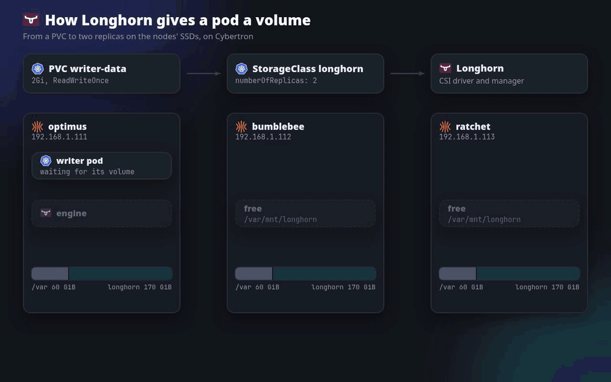

# Part 5: Storage

Companion to Part 5 of the Cybertron series: the single 256 GB SSD in each
node is split into a 60 GiB `/var` and a 170 GiB Talos user volume, and
Longhorn replicates volumes across the three nodes, with hourly snapshots,
optional nightly backups to AWS S3 and the UI on the internal Gateway.



Replace `prateek.cloud`, the bucket name and the `192.168.1.x` addresses with
your own. Run the commands from the repository root, in bash.

## Versions

| Component | Version |
| --- | --- |
| Talos | 1.14.3, managed by Omni (Part 4) |
| Kubernetes | 1.36.4 |
| Longhorn | 1.13.0 (V1 data engine; needs Kubernetes 1.34+) |
| busybox (demo) | 1.37.0 |

## Files

| Path | What |
| --- | --- |
| `omni/extensions.yaml` | Omni ExtensionsConfiguration: iscsi-tools, tailscale, util-linux-tools |
| `omni/storage-patch.yaml` | Omni config patch: cap EPHEMERAL at 60 GiB, user volume `longhorn` (170 GiB) on the system disk |
| `longhorn/namespace.yaml` | `longhorn-system` with the privileged Pod Security level |
| `longhorn/values.yaml` | Helm values: data path, two replicas, node-down policy, HTTPRoute for the UI |
| `longhorn/values-backup.yaml` | Helm values: the optional S3 backup target |
| `longhorn/recurring-jobs.yaml` | Hourly snapshots, weekly trim |
| `longhorn/recurring-backup.yaml` | Optional nightly backups |
| `demo/writer.yaml` | Test workload: verifies a checksum on start, logs a heartbeat per second |

## Before you start

Tools: `omnictl`, `talosctl` 1.14, `kubectl`, `helm`. The cluster from Parts 1 to 4,
with Tailscale on every node and Omni managing it.

```bash
export TALOSCONFIG=~/.talos/config        # the Omni talosconfig from Part 4
talosctl -n 192.168.1.111 etcd snapshot ~/cybertron/etcd-before-storage.db
```

## 1. System extensions

The list replaces what the nodes have, so it includes Tailscale. Omni rolls the
control planes one at a time (drain, new image, reboot, uncordon) and keeps `/var`.

```bash
omnictl apply -f storage/omni/extensions.yaml
talosctl -n 192.168.1.111,192.168.1.112,192.168.1.113 get extensions
talosctl -n 192.168.1.111,192.168.1.112,192.168.1.113 services | grep ext-   # ext-iscsid Running
```

## 2. A Longhorn partition on the system disk

The node patches from Part 4 delete `VolumeConfig EPHEMERAL`; that block is
removed in `omni/patches/<node>.yaml` so the cluster patch's cap survives.

```bash
omnictl get configpatches -o yaml > ~/cybertron/configpatches-before-storage.yaml
omnictl apply -f storage/omni/storage-patch.yaml
for n in optimus bumblebee ratchet; do omnictl apply -f omni/patches/$n.yaml; done
```

The cap only applies when EPHEMERAL is created. Omni refuses `talosctl reset`,
so wipe a node by removing it from the cluster and adding it back: Omni resets
it (EPHEMERAL, STATE, etcd/kubelet/containerd/log data), and on re-add builds
the config again from the patches. Omni deletes the machine's own patches when
it leaves the cluster, so re-apply `omni/patches/<node>.yaml` and
`omni/patches/<node>-static-ip.yaml` before adding it back. An imported node
also loses its link to Omni (it was in the wiped config): give it a join config
over the maintenance API.

The wipe deletes the node's etcd data (it leaves etcd first and rejoins as a
new member), images, logs, emptyDir and hostPath data, and Tailscale's login.
Tailscale is fixed for all three nodes at once after the wipes (below).

One node at a time, only when etcd has three members (ratchet first, the VIP is
on bumblebee):

```bash
talosctl -n 192.168.1.111 etcd members
omnictl jointoken machine-config > ~/cybertron/omni-join.yaml   # secret, keep out of git
# Omni UI: cybertron → ratchet → Destroy
watch talosctl -n 192.168.1.111 etcd members   # two members
talosctl apply-config --insecure -n 192.168.1.113 --file ~/cybertron/omni-join.yaml
omnictl apply -f omni/patches/ratchet.yaml
omnictl apply -f omni/patches/ratchet-static-ip.yaml
omnictl get configpatches | grep <ratchet-machine-id>   # both patches back
# Omni UI: Cluster Scaling → CP on ratchet → Update
watch talosctl -n 192.168.1.111 etcd members   # three, ratchet with a new ID
talosctl -n 192.168.1.113 get discoveredvolumes      # EPHEMERAL ~64 GB, u-longhorn ~182 GB (numbers can vary)
talosctl -n 192.168.1.113 get volumestatus EPHEMERAL
talosctl -n 192.168.1.113 get volumestatus u-longhorn
# then bumblebee (.112) and optimus (.111, watching from .112)
```

Tailscale, after all three wipes. The wiped nodes wait for a login: don't open
the login link in their logs (it registers the node under your account, not the
tag). Generate a reusable, pre-approved auth key with `tag:cybertron`, add
`TS_AUTHKEY=<key>` to the Tailscale environment in all three `10-<machine-id>`
patches in the Omni UI (never in the repo), then:

```bash
tailscale status | grep -E 'optimus|bumblebee|ratchet'   # all tagged-devices
talosctl -n <node-ip> service ext-tailscale restart     # if a node hasn't logged in
```

Remove the old offline devices, approve the five routes on each node, then
remove `TS_AUTHKEY` from the patches and revoke the key.

## 3. Longhorn

```bash
kubectl apply -f storage/longhorn/namespace.yaml
helm repo add longhorn https://charts.longhorn.io
helm repo update
helm install longhorn longhorn/longhorn --version 1.13.0 \
  --namespace longhorn-system --values storage/longhorn/values.yaml
kubectl -n longhorn-system rollout status deploy/longhorn-driver-deployer

kubectl -n longhorn-system get nodes.longhorn.io       # three nodes, schedulable
kubectl get storageclass                               # longhorn (default)
curl -sI https://longhorn.lab.prateek.cloud | head -1  # the UI; it has no login
```

## 4. Test workload

```bash
kubectl apply -f storage/demo/writer.yaml
kubectl -n storage-demo rollout status deploy/writer
kubectl -n storage-demo logs deploy/writer             # blob: OK
kubectl -n longhorn-system get volumes.longhorn.io \
  -o custom-columns=VOLUME:.metadata.name,STATE:.status.state,ROBUSTNESS:.status.robustness,NODE:.status.currentNodeID
kubectl -n longhorn-system get replicas.longhorn.io \
  -o custom-columns=REPLICA:.metadata.name,VOLUME:.spec.volumeName,NODE:.spec.nodeID,STATE:.status.currentState
```

## 5. Snapshots

```bash
kubectl apply -f storage/longhorn/recurring-jobs.yaml    # hourly snapshots (keep 24), weekly fstrim
```

## 6. Optional: backups to AWS S3

Create a bucket and an IAM user limited to it (`s3:PutObject`, `s3:GetObject`,
`s3:ListBucket`, `s3:DeleteObject` on `arn:aws:s3:::<bucket>` and
`arn:aws:s3:::<bucket>/*`), and an access key for the user. Set the bucket and
region in `longhorn/values-backup.yaml`. Then:

```bash
read -r  AWS_KEY_ID
read -rs AWS_SECRET
kubectl -n longhorn-system create secret generic longhorn-s3 \
  --from-literal=AWS_ACCESS_KEY_ID="$AWS_KEY_ID" \
  --from-literal=AWS_SECRET_ACCESS_KEY="$AWS_SECRET"
unset AWS_KEY_ID AWS_SECRET

helm upgrade longhorn longhorn/longhorn --version 1.13.0 --namespace longhorn-system \
  --values storage/longhorn/values.yaml --values storage/longhorn/values-backup.yaml
kubectl -n longhorn-system get backuptargets.longhorn.io   # AVAILABLE true
kubectl apply -f storage/longhorn/recurring-backup.yaml    # nightly, keep 14
```

## Rollback

Longhorn: delete every Longhorn PVC first, then set the
`deleting-confirmation-flag` setting to `true` and `helm uninstall longhorn
-n longhorn-system`. The partition: delete the `400-cybertron-storage` patch
(`omnictl delete configpatch 400-cybertron-storage`), then wipe the user volume
with `talosctl wipe disk <partition> --drop-partition` (the `u-longhorn` partition
from `talosctl get discoveredvolumes`; its number can differ per node). EPHEMERAL stays at 60 GiB until
the node is wiped again as in step 2.
