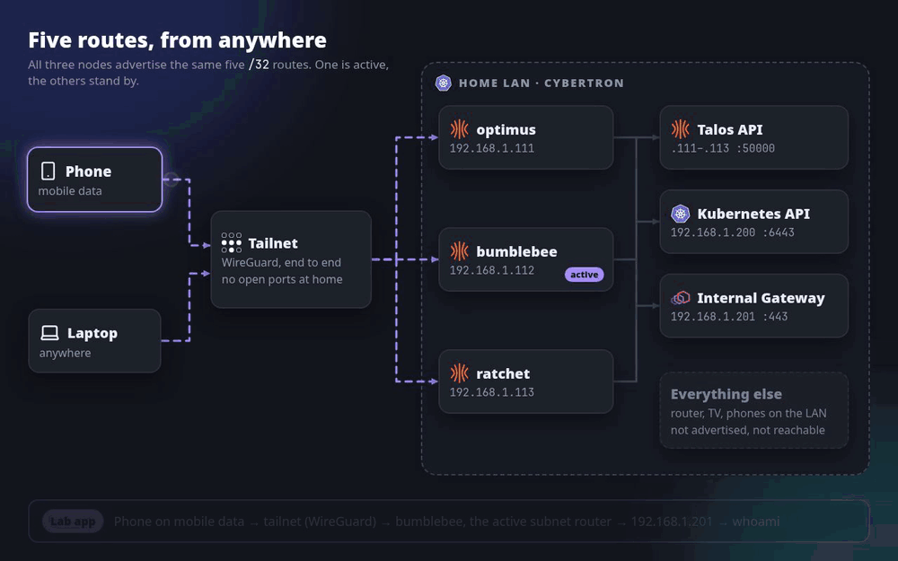

# Part 3: Remote access with Tailscale

Companion to Part 3 of the Cybertron series,
[Tailscale on Talos Linux: Secure Remote Access to a Kubernetes Homelab](https://blog.prateekjain.dev/tailscale-on-talos-linux-secure-remote-access-to-a-kubernetes-homelab-8a082d903682?sk=c4ec5ac1e782a83b5dc785211d9fd082).

Tailscale runs on the three Talos nodes as a system extension. Each node advertises the same five
/32 routes (the three nodes, the API VIP and the internal Gateway), and an access policy limits
what the tailnet can reach. The result: the same addresses, certificates, kubeconfig and
talosconfig from anywhere, with no port open on the router.



```
  phone, laptop (anywhere)
          │  WireGuard, encrypted, no inbound ports at home
       tailnet ── policy: only these five addresses and ports
          │
 ┌────────┼────────────────── HOME LAN · CYBERTRON ─────────────────┐
 │        ▼  one node is the active subnet router, two stand by     │
 │   optimus .111     bumblebee .112     ratchet .113               │
 │        │                                                         │
 │        ├──► 192.168.1.111-113 :50000    Talos API, talosctl      │
 │        ├──► 192.168.1.200     :6443     Kubernetes API, kubectl  │
 │        └──► 192.168.1.201     :80,443   Gateway, lab apps        │
 │                                                                  │
 │   everything else on the LAN (router, TV, phones): not routed    │
 └──────────────────────────────────────────────────────────────────┘
```

Replace the domain and the `192.168.1.x` addresses with yours. Run the commands from the
repository root, in bash.

## Versions

| Component | Version |
| --- | --- |
| Talos | 1.14.0 (machine config generated by talosctl 1.13) |
| Tailscale extension | `siderolabs/tailscale`, Tailscale 1.102.2 |
| Tailscale plan | Personal (free) |
| Cilium | 1.20.2 |

## Files

| Path | What |
| --- | --- |
| `policy.hujson` | Tailscale access policy: tag owner, auto-approved routes, ACLs |
| `schematic.yaml` | Image Factory schematic: default Talos plus the Tailscale extension |
| `extension-service.yaml` | The extension's configuration, one copy per node (template, no key) |
| `node-ip.yaml` | Keeps the kubelet node IP and the etcd peer address on the LAN |
| `cilium-values.yaml` | Pins Cilium to the LAN interface, layered on `networking/cilium/values.yaml` |

## 1. Access policy and auth key

Paste `policy.hujson` into the admin console (Access controls). Then Settings, Keys: generate an
auth key that is reusable, not ephemeral, tagged `tag:cybertron`, with the longest expiry.

## 2. Installer image with the extension

```bash
curl -s -X POST --data-binary @tailscale/schematic.yaml https://factory.talos.dev/schematics
# {"id":"<schematic-id>"}
curl -s https://factory.talos.dev/version/v1.14.0/extensions/official | grep -o '"siderolabs/tailscale"'
export TALOS_IMAGE=factory.talos.dev/metal-installer/<schematic-id>:v1.14.0
```

## 3. Configure the nodes before the upgrade

Configure first. Talos only marks a node booted when every service runs, so a node that gets the
extension without its configuration stays in the booting stage, `talosctl upgrade` keeps waiting
and the node stays cordoned.

Two patches per node: the extension's configuration, and `node-ip.yaml`, which keeps the kubelet
node IP and the etcd peer address on the LAN (otherwise a node can pick its 100.x tailnet address).
Both apply without a reboot. The filled-in extension file contains the auth key, so keep it
outside the repository.

```bash
read -rs TS_AUTHKEY
umask 077
for n in optimus:111 bumblebee:112 ratchet:113; do
  name=${n%%:*}; ip=192.168.1.${n##*:}
  sed -e "s/<tailscale-auth-key>/$TS_AUTHKEY/" -e "s/<node>/$name/" \
    tailscale/extension-service.yaml > ~/cybertron/patches/tailscale-$name.yaml
  talosctl -n $ip patch machineconfig \
    --patch @tailscale/node-ip.yaml \
    --patch @$HOME/cybertron/patches/tailscale-$name.yaml --mode=no-reboot
done
unset TS_AUTHKEY

talosctl -n 192.168.1.111 get extensionserviceconfigs
```

On a machine config generated by talosctl 1.14, the kubelet part of `node-ip.yaml` goes in a
`KubeNodeConfig` document instead.

Set Cilium up for `tailscale0` before the upgrade too (`cilium-values.yaml`):

- `tailscale0` must be a Cilium device. Tailnet traffic to the Gateway's LoadBalancer IP arrives
  on `tailscale0`, and Cilium only load-balances LoadBalancer IPs on its own devices; otherwise
  the node ARPs for `192.168.1.201`, nothing answers, and lab apps time out over the tailnet.
- The MTU stays at 1500. With auto-detection Cilium sizes pods for `tailscale0`'s 1280 and QUIC
  from pods (cloudflared) stops working.

Use your own LAN interface name (`talosctl -n <node-ip> get links`).

```bash
helm upgrade cilium cilium/cilium --version 1.20.2 -n kube-system \
  -f networking/cilium/values.yaml -f tailscale/cilium-values.yaml
kubectl -n kube-system rollout restart ds/cilium
kubectl -n kube-system rollout status ds/cilium
```

## 4. Upgrade the nodes, one at a time

Update `talosctl` to 1.14 first. `talosctl health` gets the control plane nodes explicitly,
because Talos discovery now also lists each node's tailnet address.

```bash
talosctl -n 192.168.1.113 upgrade --image "$TALOS_IMAGE"
kubectl wait --for=condition=Ready node/ratchet --timeout=10m
talosctl health --nodes 192.168.1.111 \
  --control-plane-nodes 192.168.1.111,192.168.1.112,192.168.1.113
talosctl -n 192.168.1.113 get extensions
talosctl -n 192.168.1.113 services | grep tailscale
kubectl get nodes -o wide                 # INTERNAL-IP stays 192.168.1.x
talosctl -n 192.168.1.111 etcd members    # peer URLs stay 192.168.1.x

talosctl -n 192.168.1.112 upgrade --image "$TALOS_IMAGE"
kubectl wait --for=condition=Ready node/bumblebee --timeout=10m

talosctl -n 192.168.1.111 upgrade --image "$TALOS_IMAGE"
kubectl wait --for=condition=Ready node/optimus --timeout=10m
talosctl health --nodes 192.168.1.112 \
  --control-plane-nodes 192.168.1.111,192.168.1.112,192.168.1.113
```

Every later Talos upgrade needs `--image "$TALOS_IMAGE"` too: without it, `talosctl upgrade`
installs the default installer for your client version, which has no extensions.

Once all three nodes show up in the admin console, revoke the auth key (Settings, Keys). The nodes
keep their state in `/var/lib/tailscale` and don't need it again.

## 5. Your own devices and checks

Linux laptop: install, start the service, log in with your own account (the command prints a
login link). `--accept-routes` is needed on Linux to use the advertised routes. macOS, Windows,
iOS and Android: install the Tailscale app and sign in; routes are accepted automatically.

```bash
curl -fsSL https://tailscale.com/install.sh | sh   # or on Arch: sudo pacman -S tailscale
sudo systemctl enable --now tailscaled
sudo tailscale up --accept-routes

tailscale status                     # the nodes show as tagged-devices
ip route get 192.168.1.201           # dev tailscale0 table 52
talosctl -n 192.168.1.113 read /proc/sys/net/ipv4/ip_forward
kubectl -n kube-system exec ds/cilium -c cilium-agent -- cilium-dbg status | grep Devices   # enp1s0 and tailscale0
kubectl -n kube-system get cm cilium-config -o jsonpath='{.data.mtu}{"\n"}'                # 1500
kubectl -n cloudflared get pods -o wide
```

## 6. Tests

```bash
curl -s https://whoami.lab.prateek.cloud | grep -E "^Hostname|X-Forwarded-For"
kubectl get nodes
talosctl health --nodes 192.168.1.111 --control-plane-nodes 192.168.1.111,192.168.1.112,192.168.1.113

# from outside the home network, these should fail: not routed, or not allowed by the policy
nc -vz -w 3 192.168.1.1 80
nc -vz -w 3 192.168.1.201 6443
nc -vz -w 3 192.168.1.200 50000

# key expiry: the tagged nodes have none
tailscale status --json | jq -r '.Self, .Peer[] | [(.DNSName | split(".")[0]), (.Tags // [] | join(",")), (.KeyExpiry // "none")] | @tsv' | column -t
```

## 7. Failover

```bash
tailscale ping 192.168.1.201    # which node answers now
tailscale status --json | jq -c '.Peer[] | select(.PrimaryRoutes) | {HostName, PrimaryRoutes}'

# terminal 1
while true; do printf '%s ' "$(date +%T)"; curl -s --max-time 2 https://whoami.lab.prateek.cloud | grep ^Hostname || echo FAIL; sleep 0.5; done
# terminal 2: reboot the node that answered
talosctl -n <node-ip> reboot
```

## Troubleshooting

| Symptom | Cause | Fix |
| --- | --- | --- |
| `talosctl upgrade` keeps printing `stage: BOOTING ready: true`; the node stays cordoned | `ext-tailscale` is "Waiting for extension service config" | Apply the extension config (step 3); the upgrade then completes |
| A node's INTERNAL-IP or etcd peer URL is `100.x` | Talos picked the tailnet address | Apply `node-ip.yaml` and reboot that node |
| cloudflared pods crash-loop on a node with Tailscale (`failed to dial to edge with quic`) | Cilium sized the pod MTU for `tailscale0` (1230) | `MTU: 1500` in `cilium-values.yaml`, restart the agents |
| Lab apps (`192.168.1.201`) time out over the tailnet, the API and talosctl work | `tailscale0` isn't a Cilium device, so the node ARPs for the LoadBalancer IP and nothing answers | `devices: [enp1s0, tailscale0]` in `cilium-values.yaml`, restart the agents |
| `talosctl health` dials `100.x:50000` and times out | Discovery lists the tailnet addresses first | Pass `--control-plane-nodes` with the LAN addresses |
| The laptop joins the tailnet but can't reach `192.168.1.201` | Linux doesn't accept subnet routes by default | `sudo tailscale up --accept-routes` |
| `tailscale status` says "Logged out" | The laptop isn't signed in yet | `sudo systemctl enable --now tailscaled`, then `sudo tailscale up --accept-routes` |
